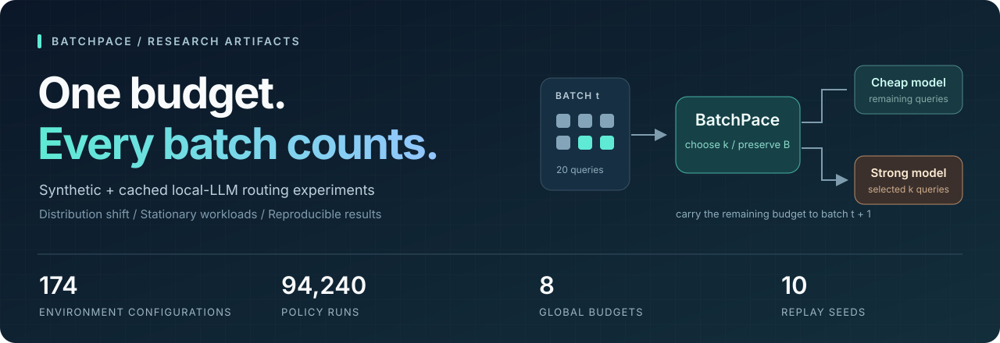
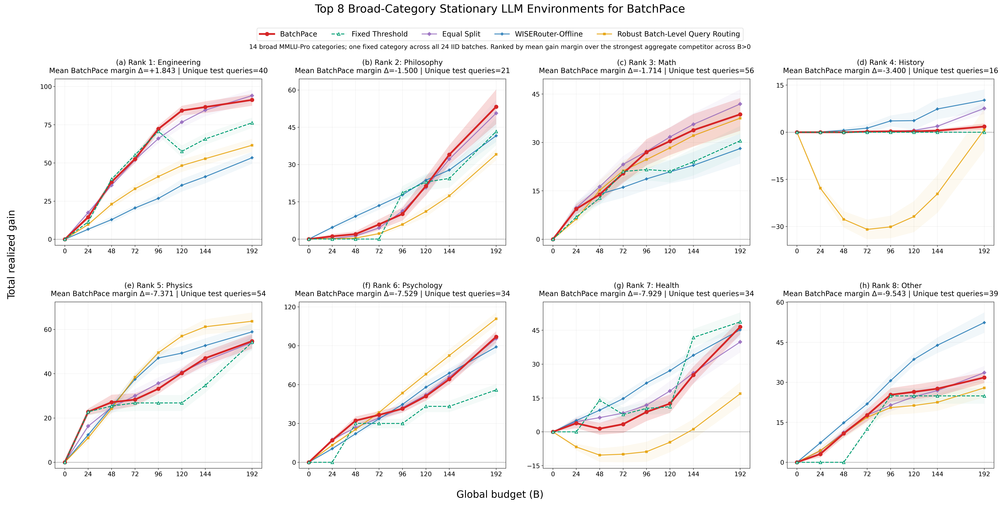
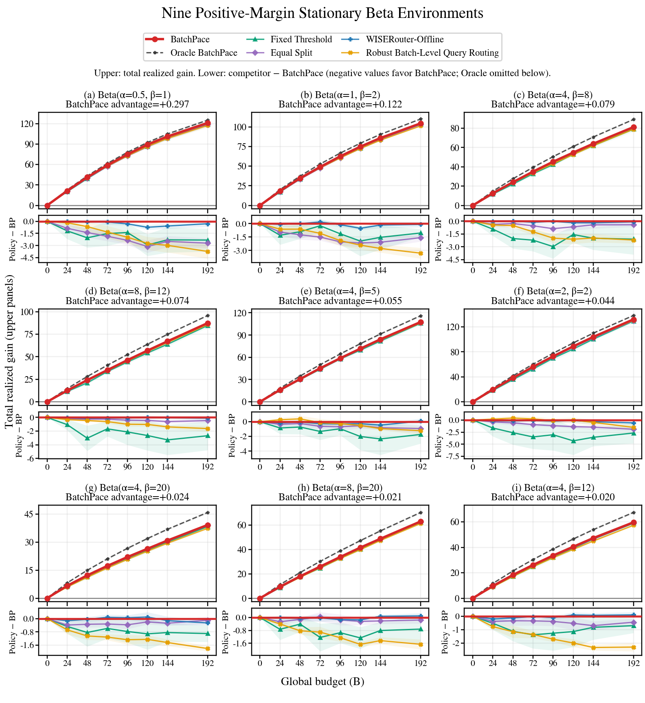
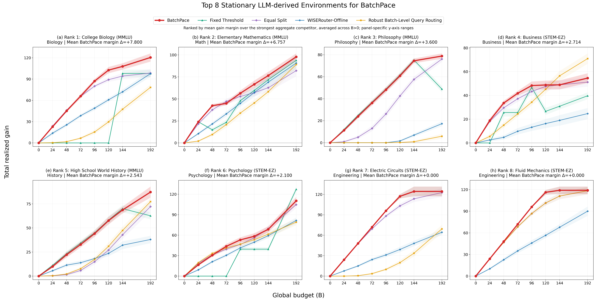
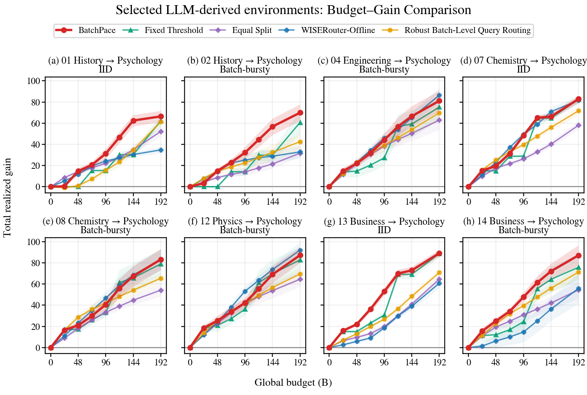
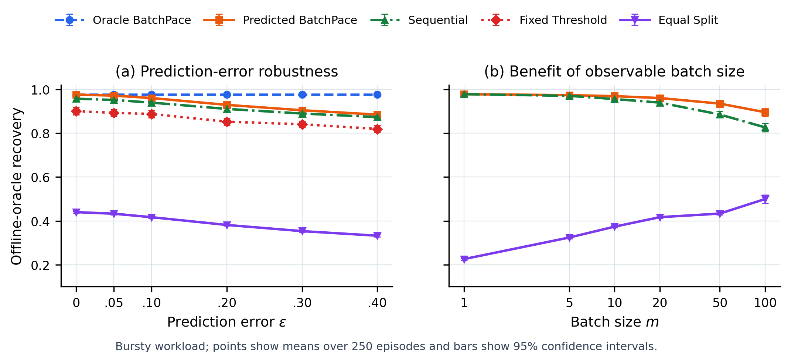
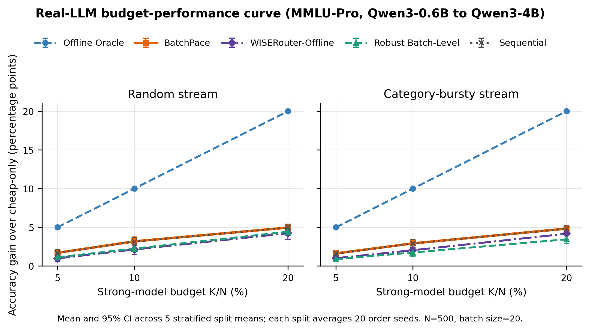

# BatchPace Routing Experiments



<p align="center">
  
  
  
  
</p>

<p align="center">
  <a href="#연구-질문">연구 질문</a> ·
  <a href="#실험-구성">실험 구성</a> ·
  <a href="#결과-요약">결과 요약</a> ·
  <a href="#그림-둘러보기">그림 둘러보기</a> ·
  <a href="#빠른-재현">빠른 재현</a> ·
  <a href="docs/EXPERIMENTS.md">상세 실험 기록</a>
</p>

## 연구 질문

**비싼 모델을 호출할 수 있는 횟수가 정해져 있을 때, 어느 배치의 어떤 질의에 예산을 써야 할까요?**

BatchPace는 현재 배치의 예상 이득과 이후 배치에 남길 예산의 가치를 함께 고려하는 질의 라우팅 정책입니다. 현재 배치에서 점수가 높은 질의를 고르고, calibration 데이터로 추정한 Bellman value를 이용해 strong model로 보낼 개수를 결정합니다.

이 저장소에는 합성 데이터 실험, Qwen/MMLU-Pro 기반의 캐시 재생 실험, 정책별 원시 결과, 논문·발표용 그림이 들어 있습니다. **분포가 중간에 바뀌는 환경**과 **시간에 따라 분포가 바뀌지 않는 stationary 환경**을 각각 평가했습니다.

```text
도착한 질의 배치 → 예상 이득 계산 → BatchPace: 현재 사용량 k 결정
                                      ├─ 선택한 k개 → Strong model
                                      └─ 나머지    → Cheap model
                                 남은 예산 B − k를 다음 배치로 전달
```

## 실험 구성

아래 5개 실험군은 총 **174개 환경 설정 · 94,240개 정책 실행 기록**으로 구성됩니다. 한 기록은 `환경 × seed × 예산 × 정책` 조합의 실행 결과입니다. 동일한 LLM 캐시를 여러 방식으로 재구성한 환경이 포함되어 있어, 환경 수가 독립 데이터셋 수를 뜻하지는 않습니다. 초기 Main Figure 1·2 실험은 별도로 보존했습니다.

| 실험군 | 환경 수 | 분포·워크로드 | 정책 수 | 실행 기록 | 결과 |
|---|---:|---|---:|---:|---|
| Synthetic · distribution shift | 40 | 5 gain families × 4 shifts × 2 regimes | 7 | 22,400 | [CSV](results/benchmark_suite/all_summary.csv) · [설계](docs/EXPERIMENTS.md#1-synthetic--distribution-shift) |
| LLM-derived · distribution shift | 40 | 20개 과목 전환 × IID / batch-bursty | 7 | 22,400 | [CSV](results/benchmark_suite/all_summary.csv) · [설계](docs/EXPERIMENTS.md#2-llm-derived--distribution-shift) |
| Synthetic · stationary Beta | 40 | 하나의 고정 Beta(α, β)에서 IID 추출 | 6 | 19,200 | [CSV](results/stationary_beta_suite/summary.csv) · [설계](docs/EXPERIMENTS.md#3-synthetic--stationary-beta) |
| LLM-derived · stationary subjects | 40 | 세부 과목 하나를 유지하며 IID 재표집 | 7 | 22,400 | [CSV](results/stationary_llm_suite/summary.csv) · [설계](docs/EXPERIMENTS.md#4-llm-derived--stationary-subjects) |
| LLM-derived · stationary categories | 14 | 대분류 하나를 유지하며 IID 재표집 | 7 | 7,840 | [CSV](results/stationary_llm_broad_suite/summary.csv) · [설계](docs/EXPERIMENTS.md#5-llm-derived--stationary-categories) |

공통 설정은 다음과 같습니다.

| 항목 | 설정 |
|---|---|
| 배치 / 질의 | 24 batches × 20 queries = **480 arrivals** |
| Strong-model 예산 B | **0, 24, 48, 72, 96, 120, 144, 192** calls |
| 예산 비율 | 0%, 5%, 10%, 15%, 20%, 25%, 30%, 40% |
| 반복 / calibration | 10 replay seeds / 200 calibration paths |
| 오차 범위 | seed 간 평균의 정규근사 95% CI |
| 분포 변화 위치 | shift 실험군에서만 batch 12 이후 |
| 제약 | 실제 strong-model 호출 수 ≤ B |

## 비교 정책

| 정책 | 의사결정 방식 |
|---|---|
| **BatchPace** | 현재 배치의 predicted gain과 미래 Bellman value로 사용 예산 결정 |
| Oracle BatchPace | 같은 배치 정책에 true gain을 제공하는 비교용 oracle |
| Sequential Pacing | 질의를 하나씩 보며 take / skip 결정 |
| Fixed Threshold | calibration에서 정한 고정 임계값과 전역 예산 제한 |
| Equal Split | 예산을 배치별로 균등 분할하고 각 배치의 top-k 선택 |
| WISERouter-Offline | context별 보상과 남은 예산을 이용하는 offline adaptive LP의 2-action 구현 |
| Robust Batch-Level Query Routing | 보수적 gain 하한과 배치별 예산 제한을 이용한 선택 |

Stationary Beta 실험에는 Sequential Pacing이 없어 6개 정책을 비교합니다. Stationary LLM 원시 결과에는 7개 정책이 모두 있으며, 그림에는 BatchPace와 4개 비교 정책을 표시합니다. Oracle BatchPace는 현재·미래 전체 질의를 미리 보는 hindsight top-B oracle과 구분됩니다. 외부 baseline의 구현 범위는 [상세 실험 기록](docs/EXPERIMENTS.md#정책-구현과-해석-범위)에 정리했습니다.

## 결과 요약

아래는 **선별하지 않은 전체 환경**에서 `B > 0`인 7개 예산과 10개 seed를 동일 가중치로 평균한 **total realized gain**입니다. 백분율이나 정확도가 아닙니다. 굵은 값은 각 열에서 oracle을 제외한 최고 평균입니다.

| 정책 | Synthetic shift | LLM shift | Beta stationary | LLM subjects | LLM categories |
|---|---:|---:|---:|---:|---:|
| **BatchPace** | **51.365** | 40.026 | 53.874 | 28.277 | 23.810 |
| Sequential Pacing | 51.299 | 40.425 | — | 27.824 | 23.720 |
| Fixed Threshold | 49.660 | 35.166 | 52.134 | 21.073 | 19.562 |
| Equal Split | 46.703 | 32.524 | 53.257 | **30.142** | 23.797 |
| WISERouter-Offline | 50.563 | **42.022** | **54.154** | 24.015 | **28.588** |
| Robust Batch-Level | 46.666 | 32.272 | 53.129 | 25.092 | 25.850 |
| Oracle BatchPace | 54.385 | 88.461 | 58.002 | 57.354 | 78.382 |

BatchPace의 상대 성능은 환경과 predictor의 품질에 따라 달라집니다. 이 집계만으로 모든 환경에서의 우위나 통계적 유의성을 주장하지 않습니다. 예산별 비교와 논문 수치는 각 실험군의 `summary.csv`, 같은 seed에서의 차이 분석은 `metrics.parquet`을 기준으로 확인할 수 있습니다. [수치의 정의와 원본 파일](docs/EXPERIMENTS.md#결과-집계-방법)

## 그림 둘러보기

### Stationary LLM · 대분류별 비교

14개 대분류 중 BatchPace의 상대 성능 순위에 따라 선택한 8개 환경입니다. 분포 전환 없이 동일한 과목 pool에서 질의를 재표집합니다. **Top-8은 전체 14개 환경의 평균을 대신하지 않으며, 모든 패널이 BatchPace의 승리를 뜻하지 않습니다.**

[](output/stationary_llm_broad_top8/stationary_llm_broad_top8_2x4.pdf)

[벡터 PDF](output/stationary_llm_broad_top8/stationary_llm_broad_top8_2x4.pdf) · [선택 기준과 순위](output/stationary_llm_broad_top8/selection_ranking.csv) · [전체 14개 결과](results/stationary_llm_broad_suite/summary.csv)

<details>
<summary><strong>Stationary Beta · positive-margin 9개 환경</strong></summary>

40개 환경 중 nonzero budget에서의 평균 margin이 양수인 9개를 선택한 그림입니다. 전체 실험 결과와 함께 해석해야 합니다.

[](output/stationary_beta_positive9_zoomed/stationary_beta_positive9_3x3_zoomed.pdf)

[벡터 PDF](output/stationary_beta_positive9_zoomed/stationary_beta_positive9_3x3_zoomed.pdf) · [선택 manifest](output/stationary_beta_positive9_zoomed/selection_positive9.csv) · [전체 40개 atlas](output/stationary_beta_40/stationary_beta_40_atlas.pdf)

</details>

<details>
<summary><strong>Stationary LLM · 세부 과목 8개 환경</strong></summary>

40개 세부 과목 중 BatchPace의 nonzero-budget 평균 gain과 가장 강한 표시 baseline의 평균 gain 차이로 순위를 매긴 8개 환경입니다.

[](output/stationary_llm_top8/stationary_llm_top8_2x4.pdf)

[벡터 PDF](output/stationary_llm_top8/stationary_llm_top8_2x4.pdf) · [선택 순위](output/stationary_llm_top8/selection_ranking.csv) · [전체 40개 atlas](output/stationary_llm_40/stationary_llm_40_atlas.pdf)

</details>

<details>
<summary><strong>Distribution shift · LLM 대표 환경</strong></summary>

초기 40개 LLM shift 환경 중 선별한 8개입니다. Batch 12 이후 과목이 바뀌며 IID와 batch-bursty를 비교합니다.

[](output/selected_llm_highlighted/selected_llm_2x4_ascending.pdf)

[벡터 PDF](output/selected_llm_highlighted/selected_llm_2x4_ascending.pdf) · [Synthetic + LLM 전체 80개 atlas](output/pdf/batchpace_80_environment_atlas.pdf)

</details>

<details>
<summary><strong>초기 Main Figure 1·2 · 통제 실험과 실제 LLM 예산 곡선</strong></summary>

**Main Figure 1:** predictor error와 batch size를 바꾸는 합성 통제 실험입니다.



**Main Figure 2:** 초기 constrained-generation 캐시를 사용한 실제 LLM replay입니다. 위 5개 실험군의 option-scoring 프로토콜과 구분됩니다.



[Figure 1 PDF](output/pdf/fig1_synthetic_controlled_study.pdf) · [Figure 2 PDF](output/pdf/fig2_real_budget.pdf) · [프로토콜과 10% 예산 결과](results/real_llm/README.md)

</details>

선별 그림은 저장된 결과를 확인한 뒤 구성한 설명용 자료입니다. 전체 성능 평가는 위 결과 표와 전체 summary를 기준으로 합니다. [그림 선택 방식](docs/EXPERIMENTS.md#그림-선택-방식)

## 빠른 재현

저장소에 포함된 option-score·embedding 캐시로 **모델 추론 없이 정책 실험을 다시 실행**할 수 있습니다. 아래 명령은 저장소 루트에서 실행합니다.

```bash
git clone https://github.com/gjtjwns06-ui/batchpace-routing-experiments.git
cd batchpace-routing-experiments
python -m pip install -r requirements-benchmark.txt
```

### 분포 변화 실험 · Synthetic 40 + LLM 40

```bash
python scripts/run_benchmark_suite.py --part all --seeds 10 --calibration-paths 200
python scripts/plot_benchmark_suite.py
```

### Stationary 실험 · Beta 40 + 세부 과목 40 + 대분류 14

```bash
python scripts/run_stationary_beta_suite.py
python scripts/plot_stationary_beta_suite.py

python scripts/run_stationary_llm_suite.py
python scripts/plot_stationary_llm_suite.py

python scripts/run_stationary_llm_broad_suite.py
python scripts/plot_top8_stationary_llm_broad.py
```

### 환경·정책 검증

```bash
python -m unittest discover -s tests -v
```

실행·plot 명령은 기본 경로의 결과와 그림을 갱신합니다. 기존 결과를 보존하며 실행하려면 runner의 `--output`으로 다른 폴더를 지정하고, plotting 경로도 해당 결과에 맞추세요. Runner·plotter별 명령과 캐시 재생성 방법은 [상세 실험 기록](docs/EXPERIMENTS.md#재현-명령)에 있습니다.

## 데이터와 모델

| 구성 | 사용한 데이터·모델 |
|---|---|
| Dataset | MMLU-Pro, 고정 1,500개 질의의 train / calibration / test 500개씩 |
| Cheap model | Qwen3-0.6B · Q8_0 |
| Strong model | Qwen3-4B · Q4_K_M |
| Routing embeddings | Qwen3-Embedding-0.6B · Q8_0 · 1,024 dimensions |
| 로컬 추론 | llama.cpp Vulkan, category-matched 5-shot prompting |
| LLM realized gain | `1[strong correct] − 1[cheap correct]`, 값은 −1 / 0 / +1 |

현재 benchmark는 유효한 **option label token의 constrained conditional likelihood**로 답을 선택합니다. 답변 본문 전체의 likelihood를 계산하는 방식과는 다릅니다. 데이터 split, 모델 revision, hash는 [split manifest](data/real_llm/splits/manifest.json)와 [cache manifest](data/real_llm/cache/manifest.json)에 기록되어 있습니다. Cache manifest의 초기 generation 정확도와 현재 option-scoring 정확도는 [프로토콜 구분](docs/EXPERIMENTS.md#llm-캐시와-프로토콜-구분)을 참고하세요.

GGUF 가중치와 llama.cpp 실행 파일은 별도로 내려받아야 합니다. 처음부터 추론하려면 [모델 경로와 서버 실행법](HANDOFF.md#8-llm-option-score를-처음부터-재생성)을 확인하세요.

## 저장소 안내

```text
├── data/          합성 원본, MMLU-Pro, split·embedding 캐시
├── src/           정책, 분포 변화 환경, stationary 환경 구현
├── scripts/       데이터 준비, 추론, 실험 실행, 그림 생성
├── tests/         환경 구성·배치 표집·예산 제약 검증
├── results/       seed별 metrics, summary, manifest, option scores
├── output/        PNG / SVG / PDF, 전체 atlas와 선별 그림
├── deliverables/  그래프 재현용 JSON과 메타데이터 패키지
└── docs/          전체 실험 기록과 README 시각 자료
```

| 목적 | 문서·산출물 |
|---|---|
| 전체 실험 설계와 재현 | [상세 실험 기록](docs/EXPERIMENTS.md) |
| 초기 40 + 40 benchmark의 구현 설명 | [Benchmark suite guide](README_BENCHMARK_SUITE.md) |
| 로컬 추론 환경과 초기 인수인계 | [한국어 HANDOFF](HANDOFF.md) |
| 그래프 수치의 JSON 패키지 | [패키지 안내](deliverables/batchpace_graph_data_json_20260826/README_KO.md) |
| 초기 실제 LLM 실험의 해석 | [Main Figure 2 결과](results/real_llm/README.md) |

환경 정의, 표집 pool 크기, baseline 축약 범위와 CI 계산법을 함께 공개해 결과를 추적하고 재현할 수 있도록 구성했습니다.
